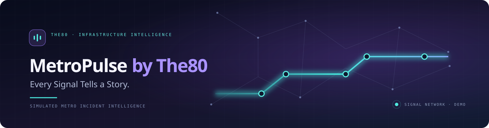
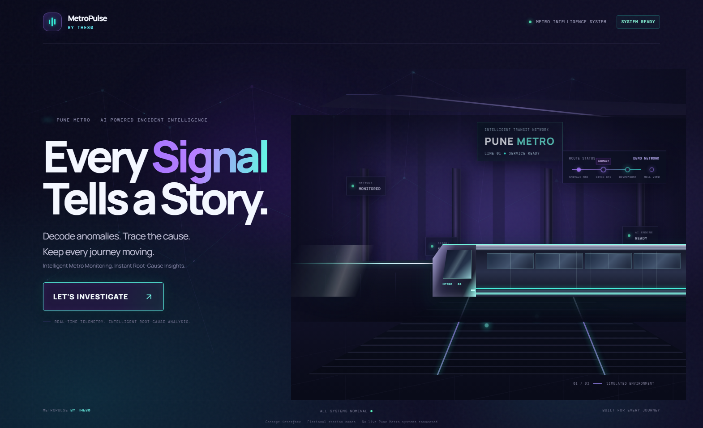
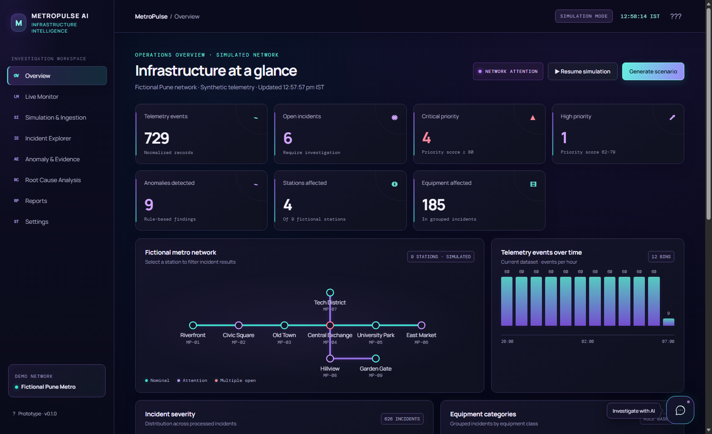
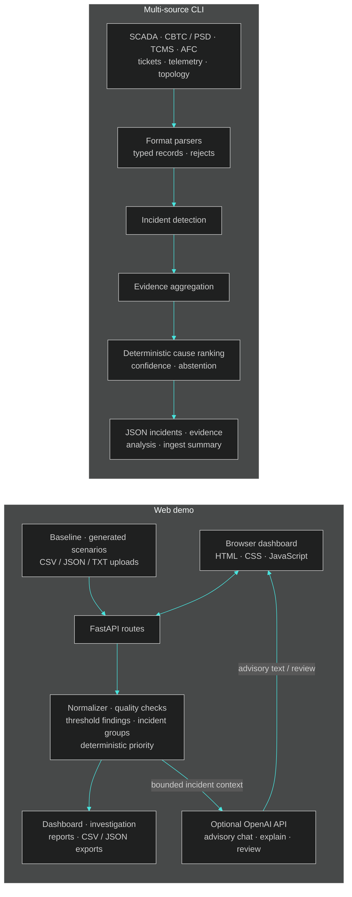
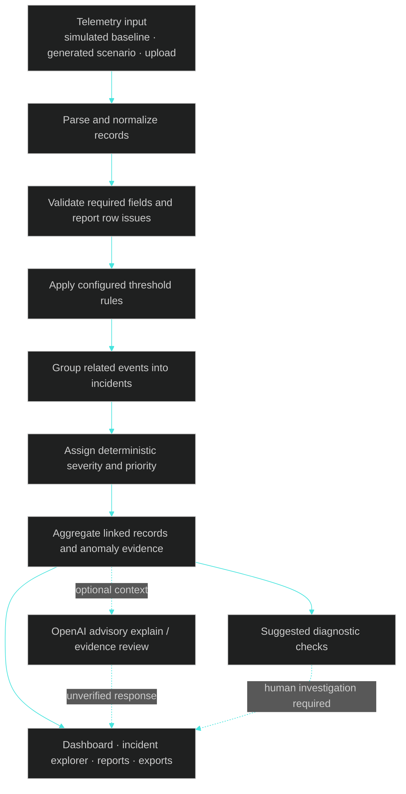
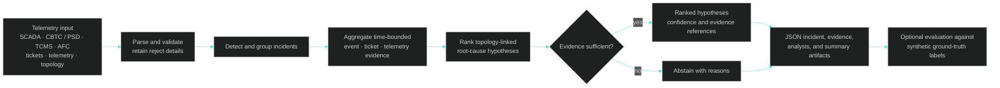

<div align="center">
  
  <p><strong>Every Signal Tells a Story.</strong></p>
  <p>An evidence-led metro incident intelligence prototype by The80.</p>
</div>

<p align="center">
  
  
</p>

> **Prototype notice:** MetroPulse does not connect to or control a real metro system. The web dashboard uses simulated telemetry and fictional Pune Metro station names. The CLI accepts the sample files included in this repository. Treat uploads and AI output as unverified prototype data.

## What it does

MetroPulse brings together two related but separate workflows for exploring metro incident data:

- The **web demo** ingests a built-in simulated dataset, generated scenarios, or user supplied CSV, JSON, and TXT records. It normalizes records, applies rule thresholds, groups incidents, assigns a transparent priority score, and provides evidence views, exports, and optional OpenAI explanations.
- The **multi-source CLI** parses the bundled SCADA, CBTC/PSD, TCMS, AFC, ticket, telemetry, and topology files. It builds incidents and evidence bundles, then ranks deterministic root-cause hypotheses with confidence and abstention states. This pipeline currently runs from the command line; it is not wired into the web API.

### Capabilities

| Area | Implemented behavior |
| --- | --- |
| Web monitoring | Simulated dashboard, incident list, station map, event summaries, anomaly and evidence views |
| Data intake | CSV, JSON, and TXT uploads up to 5 MiB; row validation and a processing summary |
| Demo simulation | Generate named failure scenarios; start, pause, tick, or reset simulated playback |
| Web prioritization | Rule-based anomaly findings, incident grouping, and deterministic priority scores |
| Web investigation | Linked records, evidence, and suggested diagnostic checks; causal conclusions remain unconfirmed |
| Optional AI | OpenAI-backed chat, incident explanation, and advisory evidence review using supplied incident context |
| CLI analysis | Multi-source parsing, incident detection, evidence aggregation, deterministic cause ranking, and abstention |
| Reports | Web incident/anomaly summaries and JSON/CSV data exports; CLI JSON artifacts |

## Architecture

The browser application and the multi-source analysis CLI share a project and sample domain, but currently run as separate paths.



## End-to-end workflows

### Web demo



Web **AI evidence review is advisory**; it does not independently verify an event. The API does not implement deterministic causal hypothesis ranking. The incident detail view explicitly states that root cause is not inferred. The “Root Cause Analysis” screen presents the current incident, evidence, and suggested checks; it does not establish a cause.

The landing page includes aspirational copy about real-time telemetry and root-cause insights. Those phrases do not describe current web functionality: the web app uses simulated or uploaded sample records, and it does not infer a root cause.

### Multi-source CLI



The CLI evaluation harness reads `data/ground_truth.json`; the detection and ranking engines do not. Evaluation results depend on the bundled synthetic dataset and are not evidence of performance on live systems.

## Technology and module map

The app uses Python, FastAPI, Pydantic, and Uvicorn on the server, with a static HTML/CSS/vanilla JavaScript frontend. The CLI uses Python and scikit-learn for text similarity during incident grouping. `requirements.txt` also declares `python-multipart`, `python-dotenv`, pandas, NumPy, NetworkX, and pytest.

| Component | Responsibility |
| --- | --- |
| `backend/main.py` | FastAPI API, in-memory demo state, upload parsing, simulation controls, and static frontend serving |
| `backend/services/processor.py` | Web record normalization, validation, threshold findings, incident grouping, and priority scoring |
| `backend/services/data_generator.py` | Fictional stations, baseline records, and generated scenarios |
| `backend/services/openai_ai.py` | Optional server-side OpenAI calls and advisory responses |
| `frontend/` | Vanilla JavaScript dashboard, page views, styles, landing page, and AI chat client |
| `metropulse/ingest/` | CLI parsers and loaders for the bundled source formats |
| `metropulse/engines/incident.py` | CLI incident detection and grouping |
| `metropulse/engines/evidence.py` | CLI evidence bundle construction |
| `metropulse/engines/rootcause.py` | CLI deterministic hypothesis ranking, confidence, and abstention |
| `metropulse/topology.py` · `schemas.py` · `knowledge_base.py` | CLI network model, typed records, and rule/pattern knowledge |
| `metropulse/eval.py` | Synthetic-label evaluation; separate from runtime engines |
| `backend/tests/` · `metropulse/tests/` | API/processor and CLI parser/engine tests |

### Repository layout

```text
The80/
├── backend/                 FastAPI app, services, tests, demo data
├── frontend/                Static browser UI and styles
├── metropulse/              Multi-source CLI, parsers, engines, tests
├── data/                    Bundled synthetic logs, telemetry, topology, labels
├── out/                     Generated CLI artifacts and current local outputs
├── docs/assets/             README banner and captured page screenshots
├── .env.example             OpenAI configuration template (no real key)
├── requirements.txt         Python dependencies
└── README.md
```

## Requirements and setup

- Python **3.10 or newer**
- `pip`
- No Node.js build step is required; FastAPI serves the static frontend.
- An OpenAI API key is optional and only needed for the AI routes.

From the `The80/` directory, create an environment and install dependencies:

```powershell
python -m venv .venv
.venv\Scripts\Activate.ps1
python -m pip install -r requirements.txt
```

On macOS or Linux, activate with `source .venv/bin/activate` instead. Start the local app:

```powershell
python -m uvicorn backend.main:app --reload
```

Open <http://127.0.0.1:8000>. FastAPI's interactive API documentation is at <http://127.0.0.1:8000/docs>.

### Optional OpenAI setup

To enable OpenAI AI investigation, open `The80/.env` and replace the placeholder `OPENAI_API_KEY` with your OpenAI API key. `OPENAI_MODEL` defaults to `gpt-4o-mini`; set it to a model available to your OpenAI API project if needed. Never put the key in frontend files, HTML, JavaScript, or browser environment variables. The backend sends only the selected incident's bounded evidence context to OpenAI when you request a review, explanation, or chat response.

- `GET /api/ai/status` checks the configured model against OpenAI and reports online only when the credentials and model are accepted.
- `POST /api/ai/chat` answers using bounded context from current incidents, anomalies, and telemetry.
- `POST /api/ai/explain` generates an advisory incident explanation.
- `POST /api/ai/verify` returns structured advisory evidence review JSON.
- `POST /api/ai/voice/connect?incident_id=...` creates a backend-authorized Realtime WebRTC session from an SDP offer and returns the SDP answer.

```powershell
Copy-Item .env.example .env
```

Edit `.env` locally and replace the placeholder with a key from your OpenAI account. Without a key, the dashboard and non-AI APIs still run; AI requests report that OpenAI is not configured. Never commit `.env`, put a key in frontend code, or paste it into an issue or screenshot.

| Variable | Default | Purpose |
| --- | --- | --- |
| `OPENAI_API_KEY` | unset | Server-side credential for optional OpenAI requests |
| `OPENAI_MODEL` | `gpt-4o-mini` | Model ID sent to OpenAI; must be enabled for the key |

## Run the CLI pipeline

Run from the `The80/` directory to load the bundled synthetic data and write artifacts under `out/`:

```powershell
python -m metropulse.cli run --data data --out out
```

The command writes `out/incidents.json`, `out/ingest_summary.json`, `out/evidence/INC-*.json`, and `out/analysis/INC-*.json`. A rerun replaces only generated files matching the `INC-###.json` naming pattern within the evidence and analysis folders.

Evaluate against the bundled synthetic labels:

```powershell
python -m metropulse.eval --data data --out out/scorecard.json
```

This scorecard is a development aid for the bundled sample only. The project does not include a live metro dataset or held-out operational evaluation set.

## API reference

The route list below is verified against `backend/main.py`. All API data is marked simulated unless it comes from an uploaded sample. Uploads enter the in-memory web demo dataset; restarting the server or resetting the demo clears them.

| Method | Path | Purpose |
| --- | --- | --- |
| `GET` | `/api/health` | Health and simulation-mode status |
| `GET` | `/api/config` | Fictional network, thresholds, scenario definitions, and capability flags |
| `GET` | `/api/dashboard` | Current dashboard summary, events, incidents, and playback state |
| `GET` | `/api/incidents` | Incident list; optional `q`, `station`, `severity`, `limit` query parameters |
| `GET` | `/api/incidents/{incident_id}` | Incident, linked records, anomalies, and suggested diagnostic checks |
| `GET` | `/api/anomalies` | Rule-based findings with source record context |
| `GET` | `/api/processing/summary` | Counts and row-quality summary |
| `POST` | `/api/processing/run` | Reprocess the current in-memory dataset |
| `GET` | `/api/ingestion/history` | In-memory baseline, upload, and scenario history |
| `GET` | `/api/ingestion/preview` | First 20 current input records and total count |
| `POST` | `/api/ingestion/upload` | Multipart field `file`; CSV, JSON, or TXT; max 5 MiB |
| `GET` | `/api/ingestion/export/{format}` | Export current records as `json` or `csv` |
| `POST` | `/api/simulation/generate` | JSON body `{"scenario":"communications"}`; supported keys are returned by `/api/config` |
| `POST` | `/api/simulation/control` | Query parameter `action=start`, `pause`, or `reset` |
| `POST` | `/api/simulation/tick` | Add a nominal simulated batch when playback is active |
| `GET` | `/api/ai/status` | Check optional OpenAI configuration and model availability |
| `POST` | `/api/ai/chat` | Advisory chat grounded in bounded current demo context |
| `POST` | `/api/ai/explain` | Advisory explanation for `{"incident_id":"…"}` |
| `POST` | `/api/ai/verify` | Advisory evidence review for `{"incident_id":"…"}` |

AI routes accept JSON and are limited in memory to 20 requests per minute per client address. `/api/ai/status` may make an outbound OpenAI model-list request when a key is configured. The app also mounts the frontend at `/`.

## Demo guide

1. Start the web app and open the local URL. The landing page describes the fictional demo; choose the workspace entry action to open the dashboard.
2. Explore the Overview, Live Monitor, Incident Explorer, Anomaly & Evidence, Reports, and Settings pages.
3. In **Simulation & Ingestion**, generate a supported scenario or upload a sample CSV/JSON/TXT file. The upload must contain usable `timestamp`, `station_id`, and `equipment_id` fields for accepted records.
4. Open an incident to inspect linked records, threshold findings, and suggested checks. The interface presents evidence and heuristic priority; it does not confirm a cause.
5. To try the CLI workflow, run the commands above and inspect the JSON in `out/`.
6. Configure OpenAI only if you want to try the optional chat, explanation, or evidence-review features.

## Testing

Run the repository test suite from `The80/`:

```powershell
python -m pytest
```

Tests cover the web API and processor, CLI parsers, incident detection, evidence construction, and root-cause ranking. They use project test fixtures; passing tests do not validate live transit operations or an external data source.

## Limitations and next steps

- The web network, station labels, playback, baseline records, and generated failure events are simulated. User uploads are treated as sample data, not authenticated telemetry.
- The web backend keeps dataset state in process memory; it has no persistent database, user accounts, or multi-user isolation.
- Web anomaly detection and priorities are rule/heuristic based. The web API does not perform independent verification or causal hypothesis ranking; its diagnostic checks are suggestions.
- OpenAI responses are probabilistic and advisory. They can be unavailable due to missing credentials, account/model access, network failures, or provider limits.
- The deterministic CLI root-cause engine is separate from the web app and is evaluated only against bundled synthetic labels.
- No deployment setup, production monitoring, authentication, or real infrastructure integration is included.

Potential follow-up work, after validation with representative data, includes persistent and access-controlled storage, stricter schemas and provenance for source records, operational monitoring, calibrated rules, held-out evaluation, and a reviewed integration between the CLI analysis and web investigation views.

## Security and data handling

- Keep OpenAI credentials in backend environment variables or an untracked local `.env`. Do not expose keys to browser code.
- AI prompts include bounded incident, anomaly, and telemetry context. Do not send confidential, personal, or operationally sensitive records to OpenAI without authorization and an approved data-handling review.
- Uploads are limited to 5 MiB and accepted as CSV, JSON, or TXT. Validate files before use; this demo does not provide production-grade tenant isolation, durable audit storage, or authentication.
- The current backend allows cross-origin requests from any origin. Keep it bound to localhost for demos; configure authentication, authorization, and a restrictive CORS policy before any network-facing deployment.
- Never use this prototype or its AI output to operate infrastructure or make safety-critical decisions.

## Project information

- **Project name:** MetroPulse by The80 (the repository's requested project branding)
- **Team roster:** Not documented in the repository.
- **Acknowledgements:** No third-party project acknowledgements are recorded in the repository.
- **License:** No `LICENSE` file is present. Reuse and redistribution terms have not been specified.
